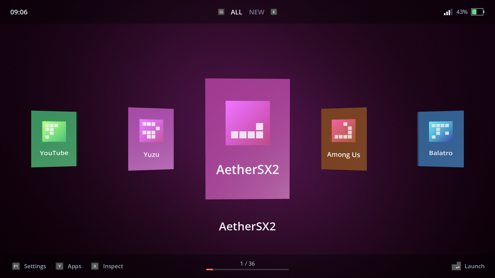

# Shelves — v0.4 "Customisation"

[](../../actions/workflows/ci.yml)



An Android home screen that shows your apps as physical game media — browse
your shelf by touch or controller and pull a game off it. It keeps what works
in Socket (snappy sound-rich UI, rotatable 3D media, a background tinted by the
icon) and fixes what breaks on a large Android library.

Godot 4.7 for everything you see, a small Kotlin plugin for everything that
needs Android.

v0.4 adds Inspect: every app can have its own media shape, finish, art, name
and launch action. Slow mode (the shelf and the open box) is v0.5.

## What v0.4 adds on top of v0.3

| Area | v0.4 |
| --- | --- |
| Media shapes | Box, cartridge, disc or card, per app, built as meshes rather than imported |
| Finishes | Opaque, translucent, clear, metallic, glitter |
| Art | Cover and label images from a watched folder — drop files in and pick them |
| Display name | Rename an app without touching Android |
| Launch action | A link, a package/activity, or the app's own launcher — this is what games inside GameNative need |
| Inspect | X on the shelf or in All apps opens it; changes show on the models immediately |
| Background | Per app: taken from the icon, or one of five palettes |
| Choice lists | Any setting with several values opens a list instead of cycling |

Layout changes: the carousel shows exactly three (previous, current, next),
and the grid is a honeycomb with the selection in the middle of the screen.

## What v0.3 added on top of v0.2

| Area | v0.3 |
| --- | --- |
| Folders | Create, rename, delete, reorder; an app can be in any number of them |
| Layout per folder | Carousel (three up) or a looping square grid with the selection centred |
| All apps | Every launchable app, searchable, with folder filing and hiding |
| Hide | Hidden apps leave every shelf and are restored from Settings |
| New | Recently installed and not yet filed — filing an app is what empties it |
| Settings | Prompt style, A/B swap, sounds and volume, idle animation, clock |
| Screens | Shared panel: list or icon grid, pad navigation, touch, prompts |
| All apps | Shown as a grid of icons; Start flips to the hidden apps and back |
| Folder editor | Open a folder to set its layout, rename it, delete it and tick which apps are in it |

Three v0.2 bugs are fixed: the model changing size after a switch, rotation
picking up pitch as well as yaw, and the yaw stopping dead at half a turn.

## What v0.2 added on top of v0.1

| Area | v0.2 |
| --- | --- |
| View | 3D carousel — selected item centre, neighbours either side, index wraps |
| Models | One generic game case, built as a mesh with the cover face on its own surface |
| Cover | Tinted from the app icon, icon on the front, title on the box |
| Animation | Idle sway, elastic switch, cartridge-insert on launch |
| Rotation | Right stick, or drag on the centre model; springs back after a few seconds |
| Top bar | Clock, folder tabs between L/R prompts, Wi-Fi and battery |
| Bottom bar | Settings / Apps / Inspect prompts, shelf indicator, Launch prompt |
| Background | Moving gradient sky shader, tinted by the selected icon's colours |
| Prompts | Controller Icons addon, with an auto / Xbox / PlayStation / Nintendo / Steam Deck override |
| Sound | Move, select, back, folder, insert |
| Data | `Library` with per-app records and two dynamic folders (All, New) |
| Android | `getBatteryState()`, `getNetworkState()`, `apps_changed` signal |

Everything still works by touch alone, and the two v0.1 input rules are kept:
the focus visuals only appear while a pad is in use, and the first pad press
after touching the screen only wakes the cursor.

## Controls

| Action | Controller | Touch |
| --- | --- | --- |
| Move selection | D-pad / left stick (hold to repeat) | Swipe anywhere outside the centre model, or tap a side item |
| Move a row (grid) | D-pad up / down | Swipe |
| Launch | A | Tap the centre model |
| Rotate the model | Right stick | Drag on the centre model |
| Previous / next folder | L1 / R1 | Tap ‹ › in the top bar |
| Jump 10 at a time | L2 / R2 | — |
| Inspect / Apps / Settings | X / Y / Start | Tap the prompt |
| In a list: file into folders / hide | X / Y | Tap the prompt |
| In All apps: show hidden apps | Start | Tap the prompt |
| Back out of a screen | B, or the Android back gesture | Tap Back |

On a keyboard: arrows, Enter, Q/E for folders, `[` `]` to jump, X/Y/F1 for the
three screens.

## Layout

```
godot/
  project.godot              Godot 4.7, mobile renderer, 1920x1080 landscape
  scenes/main.tscn           3D world + chrome; the only scene you need to open
  shaders/sky_gradient.gdshader
  sounds/                    generated UI sounds (no third-party audio)
  scripts/
    settings.gd              autoload — launcher settings, user://settings.json
    app_bridge.gd            autoload — the only code that calls the plugin
    library.gd               autoload — apps, folders, per-app records
    input_mode.gd            autoload — touch vs pad, A/B swap
    audio.gd                 autoload — sound pool, music fade
    carousel.gd              the Fast-mode view
    media_item.gd            one 3D case: materials, sway, insert animation
    box_mesh.gd              the case mesh (cover face on its own surface)
    icon_colors.gd           dominant colours from an app icon
    top_bar.gd / bottom_bar.gd / shelf_indicator.gd / button_prompt.gd
    battery_icon.gd / wifi_icon.gd / style.gd
  addons/controller_icons/   vendored, MIT, Xelu CC0 icons
  addons/shelves/    export plugin (AAR + manifest injection)
  tools/                     dev helpers, not part of the app
android-plugin/              Kotlin plugin -> LauncherPlugin.aar
```

The bars build their children in script rather than as deep scene trees, so the
whole layout of a bar reads top to bottom in one file. Positions and colours
come from `style.gd`.

## Build

1. `cd android-plugin && gradlew.bat assemble` (JDK 17, SDK at `C:\Android\sdk`).
   Create `local.properties` from `local.properties.example` first if Gradle
   cannot find the SDK. **Check the AARs actually landed** in
   `godot/addons/shelves/bin/debug/` and `.../release/` — the export plugin
   skips the plugin with an error in the Output panel if they are missing, and
   the app then falls back to mock data.
   The AARs are copied into `godot/addons/shelves/bin/`. Set
   `godotVersion` in `plugin/build.gradle.kts` to your editor version.
2. Open `godot/` and run *Project → Install Android Build Template*.
3. *Project → Export → Android*, tick **Use Gradle Build**, min SDK 24, export.
4. Press Home on the device and pick Shelves.

**If the app shows `MOCK DATA — plugin not loaded`,** the AAR did not reach the
APK. In order of likelihood: the AAR was never built (check
`godot/addons/shelves/bin/*/`), or **Use Gradle Build** was off during export —
an Android plugin can only be injected by the Gradle build, and Godot does not
warn you about it. The export plugin now prints a banner in the Output panel
when the AAR is missing, and the export dialog shows a warning next to that
option.

No Gradle locally? Take the AAR from a green CI run instead: Actions → the
latest run → Artifacts → `launcher-plugin-aar`, then drop the two files into
`godot/addons/shelves/bin/debug/` and `.../release/`.

To get back out while testing: Settings → Apps → Default apps → Home app.
Set `REGISTER_AS_HOME = false` in `addons/shelves/export_plugin.gd` to
export it as an ordinary app instead.

On a PC the launcher runs with 36 mock apps and generated icons, so the whole
UI can be worked on without deploying.

## Dev helpers

```
godot --headless --path godot tools/selftest.tscn   # navigation smoke test
godot --path godot tools/shot.tscn                  # writes user://shot.png
```

The self-test covers wrapping, folder switching, the trigger jump, the launch
lock and the fact that only seven models exist however big the library is.

## Working on it

- `main` always builds and passes CI. Work on a branch per milestone —
  `v0.3-library`, `v0.4-customization` — and merge when the milestone ends with
  a working APK.
- Tag each milestone `v0.3.0`, `v0.4.0`, ... and add its section to
  `CHANGELOG.md` in the same commit.
- CI runs on every push and pull request: it imports the project, runs the
  headless self-test, fails on any GDScript error, and assembles the plugin
  AAR (which is the part hardest to check by hand). The AAR is attached to the
  run as an artifact.
- Open questions from the design document are worth filing as issues, so the
  answers live next to the code rather than in a chat.

## Licence

MIT — see `LICENSE`. Third-party code and assets are listed in
`THIRD-PARTY.md`.

## Fixed in v0.3

- Model scale changed after a switch: the view and the switch animation were
  writing the same property. The animation moves the pivot now.
- Rotation fed pitch as well as yaw, and stopped dead at half a turn. It is
  yaw only and wraps.
- No real apps on device: the plugin AAR had never been built, because the
  repository had no Gradle wrapper despite the README telling you to run
  `gradlew.bat`. The wrapper is committed, the export plugin says loudly when
  the AAR is missing, and the launcher shows `MOCK DATA — plugin not loaded`
  rather than quietly listing apps that do not exist.

## Background

Two settings, both launcher-wide, over colours that come from the selected app:

- **Style** — `pools` (two drifting lights), `blending` (noise warped by noise,
  so the colours fold into each other in marbled bands rather than meeting on
  a clean line), `sweep` (a soft turn around the centre with a ragged edge).
- **Pattern** — `none`, `dots`, `mesh`, `triangles`, `chladni`. The last draws
  the nodal lines of a vibrating square plate, with both mode numbers drifting
  so the figure keeps rebuilding itself.
- **Speed**, separately for the gradient and the pattern: `still`, `slow`,
  `normal`, `fast`. `still` holds it completely.
- **Pattern strength**, 15 to 75%.

Everything is in one sky shader, which is why it costs a single full-screen
pass however it is configured.

## Custom 3D models (planned for v0.7, contract fixed now)

The four shapes are built by `box_mesh.gd` rather than imported, and every one
of them follows the same rule, which is also the rule an imported `.glb` will
follow:

- **Surface 0 is the art.** Its UVs are a plain 0-1 rectangle (on the disc,
  mapped round the face), and the cover or label texture goes on it.
- **Surface 1 is everything else** — back, edges, spine — and takes the body
  colour and the finish.

So a model you make in Blender needs exactly two materials, with the one on
the faces that should show the art first. Anything beyond that (a separate
spine texture, an insert) comes with Slow mode in v0.5.

## Art folder

Cover and label images are read from a folder, so no file browser or storage
permission is needed:

```
/storage/emulated/0/Shelves/art     on the device
user://art                          everywhere (made on first use)
```

PNG, JPG and WebP. Inspect lists what it finds there.

## Known gaps in v0.4

- Slow mode (shelf, spines, open box) is v0.5.
- Shaders on the media (glitch, hologram) and the background texture overlay
  are v0.6.
- Imported .glb models and the standby screen are v0.7.
- Custom launch actions are written as text; a picker that reads shortcuts
  from the app itself would be better.
- The background has the moving gradient but not the texture overlay (v0.6).
- Finishes, shaders and custom launch actions are v0.4.
- The Kotlin side is untested against a device from here — the Gradle build has
  not been compiled, only written.
- `getNetworkState()` replaces the `getWifiState()` in the design doc so the bar
  can tell "no Wi-Fi" from "on mobile data". Rename if you prefer the doc.
